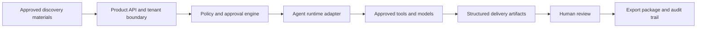

# Architecture Overview

The design separates the customer-facing product, policy enforcement, agent runtime, and stored artifacts so each boundary can be reviewed and replaced independently.

## Major components

### Product API

Coordinates authentication, tenant routing, job state, and exports. Customer-facing behavior remains separate from the underlying agent runtime.

### Policy and approval engine

Applies least-privilege tool access, validates structured outputs, and pauses consequential actions for human review.

### Agent runtime adapter

Provides a replaceable interface to models and tool execution. This avoids binding the product to one provider or deployment environment.

### Artifact store

Stores generated briefs, workflows, stories, test plans, and approval history within a tenant boundary.

### Audit trail

Records input references, model and tool events, approvals, validation results, and exported artifact versions.

## Design principles

- Private by default for customer material
- Explicit tenant boundaries
- Secrets remain outside source control
- Human approval for consequential actions
- Portable deployment interfaces
- Traceable transformations from source material to output

## Deployment portability

The same logical components can support a managed cloud deployment or a customer-controlled environment by externalizing storage, secrets, identity, model access, and observability behind adapters.
