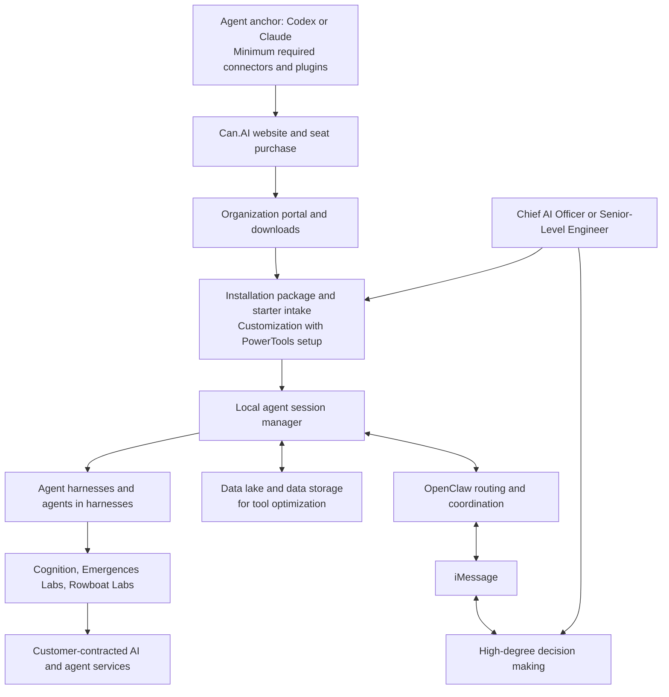

# Can.AI Architecture

This is the intended product design. The public repository contains documentation, not an implemented checkout, installer, management service, or runtime.

## Access setup to high-degree decision making

The Chief AI Officer or Senior-Level Engineer owns intake, customization, PowerTools setup, and the decision policy. High-degree decision making is the business outcome: assess options, weigh consequences, and authorize a course of action using evidence from agent work.

Cognition, Emergences Labs, and Rowboat Labs identify the proposed agent and platform integration layer. They are not three interchangeable model runtimes or verified Can.AI connectors. Each integration needs its own supported connection, licensing, execution-location, and capability check.

## Responsibility boundaries

| Component | Proposed responsibility |
| --- | --- |
| Agent anchor: Codex or Claude | Establish the primary authenticated configuration with minimum required connectors and plugins installed; verify identity, billing, and permissions |
| Website and commercial portal | Product selection, seat purchase, billing, organization membership, and installation-package downloads |
| Installation package and starter intake | Install on the office computer and capture the team's work, applications, data sources, constraints, and desired outcomes |
| Chief AI Officer or Senior-Level Engineer | Own customization, agent selection, PowerTools configuration, data scope, spending limits, and decision policy |
| PowerTools profile | A versioned bundle of agent instructions, tools, workspace scope, schedules, and review rules |
| Local session manager | Session ownership, queueing, progress, cancellation, supported continuation, and run history |
| Agent harnesses | Execution and session environments that control context, tools, permissions, continuation, and cancellation |
| Agents in harnesses | Bounded workers such as research, budget analysis, engineering evaluation, and organization-design review |
| Agent selection | Match each task with an approved agent, harness or working experience, and source requirements |
| Tool requirements and certifications | Record required capabilities, applicable certificates or audit reports, scope, validity, and internal acceptance evidence |
| Cognition, Emergences Labs, Rowboat Labs | Proposed platform connections selected and validated during customization; each retains its own capabilities and access requirements |
| Data lake and data storage for tool optimization | Governed source data, approved artifacts, retrieval indexes, and operating evidence used to improve tool selection and workflow execution |
| OpenClaw | Session and channel routing, coordination, decision-request delivery, and result delivery through supported integrations |
| iMessage | Deliver concise requests, decision briefs, and responses through the configured Messages bridge |
| Execution tools | Actual file edits, desktop operations, or connected-system actions within effective permissions |
| High-degree decision making | Turn task evidence into choices, tradeoffs, and a recorded decision owned by the assigned person |

## Integration design

Agent anchor is Can.AI's name for the starting Codex or Claude configuration. The anchor, execution harness, assigned agent, and output artifact are separate records. The [case-study harness plan](CASE_STUDY.md#4-agents-within-the-harness-plan) uses Dot, Claude workflows with Artifacts, and Cognition's developer cowork experience represented by Devin as examples. Hosted harnesses retain their execution locations, and an artifact does not become an autonomous agent merely because it displays or calculates a result.

The named organizations play different roles. Cognition's Devin documentation describes an API for sessions and integrations. Emergences Labs describes human competency and human-AI collaboration work. Rowboat Labs publishes Rowboat as an AI coworker. These are ecosystem references for evaluating Can.AI's intended integrations. [Devin API](https://docs.devin.ai/api-reference/overview), [Emergences Labs](https://emergences.ai/), [Rowboat Labs](https://www.rowboatlabs.com/)

For native Codex integration, OpenClaw documents that Codex owns its low-level session execution while OpenClaw owns the surrounding channel, session, and approval functions. ACP is a separate external-runtime integration path. The Can.AI design should preserve those boundaries rather than assume all runtimes behave identically. [Codex harness](https://docs.openclaw.ai/plugins/codex-harness), [ACP agents](https://docs.openclaw.ai/tools/acp-agents)

## Session lifecycle

A proposed run moves through `queued`, `running`, `awaiting approval`, and `completed`, with explicit `failed` and `cancelled` outcomes. Host unavailability is displayed separately. Continuation depends on the connected runtime; recovery must not repeat a previously completed external action merely because a reply was lost.

Each run references an organization, requester, office computer, connected platform and provider identity, native session identifier where available, PowerTools profile version, authorized data scope, and applicable limits. The local manager correlates those records; it does not pool unrelated users' credentials or grant one session access to another's contents.

## Data and network placement

| Location | Intended data or activity |
| --- | --- |
| Customer office computer | Local session management, editing, approved tool execution, and temporary working state |
| Data lake and data storage | Governed source collections, approved outputs, retrieval indexes, and permission-scoped operating records; placement is chosen during customization |
| Commercial portal | Seat entitlements, billing, downloads, device identifiers, and explicitly disclosed operational metadata |
| Connected AI or agent service | Only the approved context and task data required by its selected route |
| iMessage and Messages bridge | Task requests, concise decision briefs, notifications, and scoped responses |

The data lake and storage layer supports retrieval, reusable context, and evidence about tool performance. Access controls, retention, source provenance, and storage location are part of starter intake and customization. Collecting data does not automatically train a model or grant every tool access to the whole lake.

Local execution, data storage, and hosted inference are separate deployment decisions. Before enabling an integration, the Chief AI Officer or Senior-Level Engineer verifies its execution location, operating-system support, and effective permissions.

OpenClaw's documented iMessage setup uses its plugin and `imsg` on a Mac signed into Messages. A remote Mac bridge can connect an office gateway running elsewhere. This is a setup prerequisite, rather than native iMessage execution on every office computer. [OpenClaw iMessage setup](https://docs.openclaw.ai/channels/imessage/setup)

## Configuration and operations

The proposed customization process versions and tests PowerTools profiles, scopes access to the data lake, isolates session state, stores secrets using an approved credential store, and provides pause and stop controls. Decision records connect the supporting evidence, accountable person, approved scope, and execution result. Package updates, entitlement renewal, storage backups, retention, and authentication expiry have explicit operating behavior.

See the [customer journey and executive reorg case](CASE_STUDY.md) for the end-to-end experience and [security design](SECURITY.md) for the corresponding controls.
