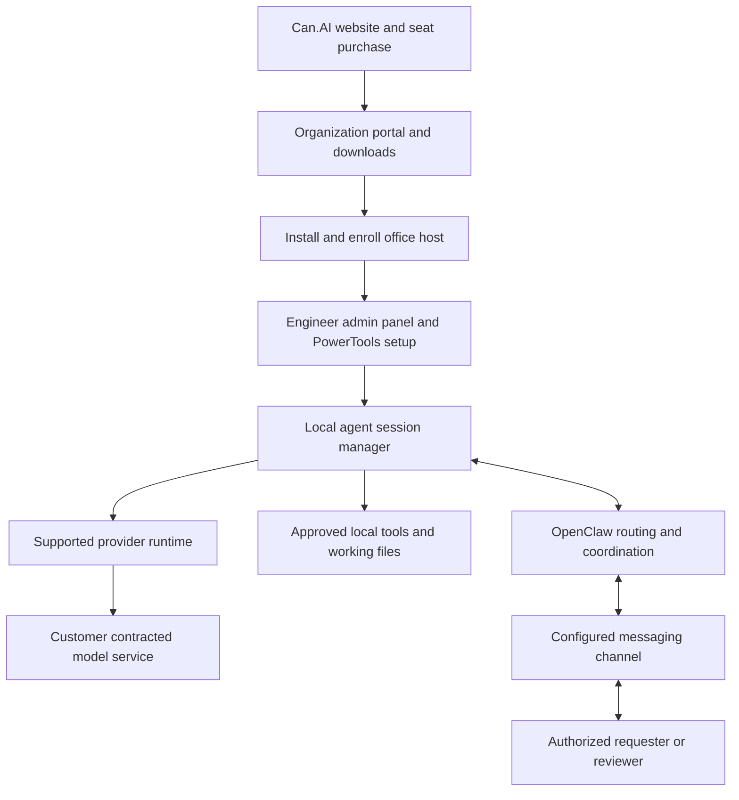

# Can.AI Architecture

This is the intended product design. The public repository contains documentation, not an implemented checkout, installer, management service, or runtime.

## Purchase to operation

## Responsibility boundaries

| Component | Proposed responsibility |
| --- | --- |
| Website and commercial portal | Product selection, seat purchase, billing, organization membership, downloads, and host entitlements |
| Installer and enrolled office host | Runtime prerequisites, local service setup, controlled upgrades, and host health |
| Engineer admin panel | Agent roles, tool permissions, identity mapping, workflow triggers, model routes, budgets, and profile publication |
| PowerTools profile | A versioned bundle of agent instructions, tools, workspace scope, schedules, and review rules |
| Local session manager | Session ownership, queueing, progress, cancellation, supported continuation, and run history |
| Provider runtime | Its native execution loop, supported authentication, model capabilities, and provider-specific session behavior |
| OpenClaw | Session and channel routing, coordination, decision-request delivery, and result delivery through supported integrations |
| Execution tools | Actual file edits, desktop operations, or connected-system actions within effective permissions |
| Human reviewer | Business decisions and approvals for the specific actions assigned to them |

For native Codex integration, OpenClaw documents that Codex owns its low-level session execution while OpenClaw owns the surrounding channel, session, and approval functions. ACP is a separate external-runtime integration path. The Can.AI design should preserve those boundaries rather than assume all runtimes behave identically. [Codex harness](https://docs.openclaw.ai/plugins/codex-harness), [ACP agents](https://docs.openclaw.ai/tools/acp-agents)

## Session lifecycle

A proposed run moves through `queued`, `running`, `awaiting approval`, and `completed`, with explicit `failed` and `cancelled` outcomes. Host unavailability is displayed separately. Continuation depends on the connected runtime; recovery must not repeat a previously completed external action merely because a reply was lost.

Each run references an organization, requester, enrolled host, provider identity, native session identifier, PowerTools profile version, workspace, and applicable limits. The local manager correlates those records; it does not pool unrelated users' credentials or grant one session access to another's contents.

## Data and network placement

| Location | Intended data or activity |
| --- | --- |
| Customer office host | Local editing, approved tool execution, workspace files, session state, and configurable audit records |
| Commercial portal | Seat entitlements, billing, downloads, enrolled-host identifiers, and explicitly disclosed operational metadata |
| Model provider | Approved prompts, context, and tool results required by the selected inference route |
| Messaging provider | Approved task requests, decision summaries, notifications, and selected results |

Local execution and hosted inference are separate deployment decisions. The default product journey assumes approved outbound connections; it does not promise air-gapped operation or fully local inference. Before enabling a tool, the engineer verifies its operating-system support, permissions, and actual behavior on the target host.

## Configuration and operations

The proposed management layer versions and tests PowerTools profiles, isolates user workspaces, stores secrets using an approved credential store, and shows a clear pause or stop control. It records what was requested, proposed, approved, and executed. Host updates, entitlement renewal, backups, retention, and authentication expiry need explicit operating behavior rather than silent fallback.

See the [customer journey](CASE_STUDY.md) for the end-to-end experience and [security design](SECURITY.md) for the corresponding controls.
